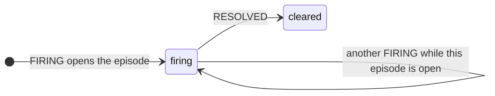
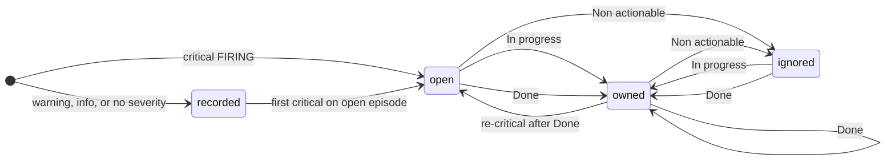
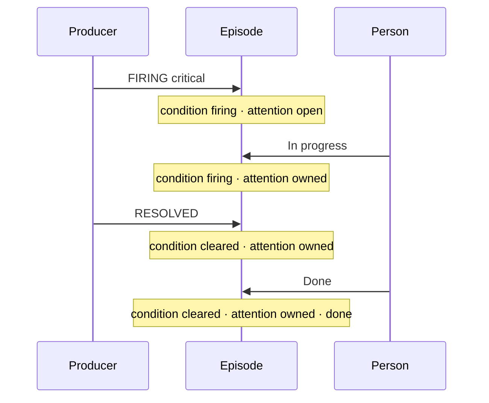
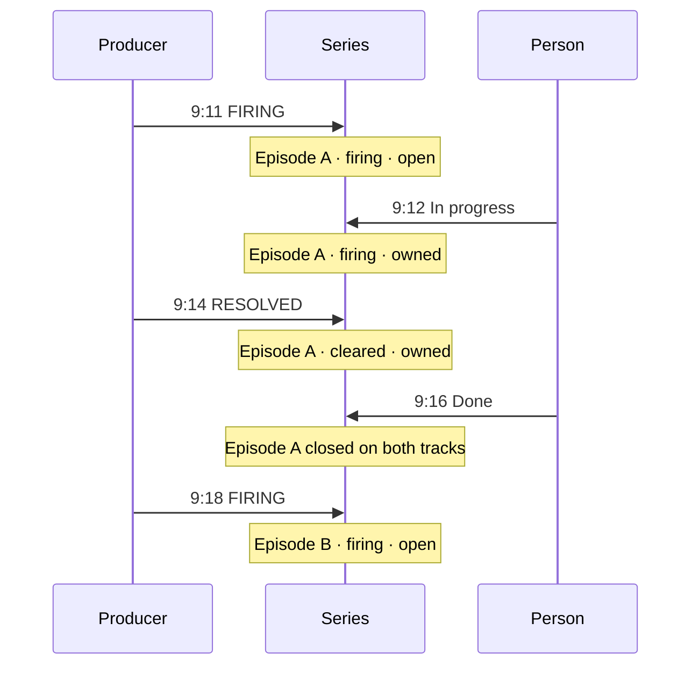

# Attention and condition

An episode carries two facts. They are written by different actors and they change on their own.

| Fact | Who writes it | Words |
| --- | --- | --- |
| **Condition** | The alert producer, through [alert intake](../../contracts/alert-intake.md) | `firing`, then `cleared` |
| **Attention** | The person, through a button | `recorded`, `open`, `owned`, `ignored` |

`DONE` is a third fact on the human side. It records that the person closed their loop. It does not clear the condition. A resolve does not close the person's loop.

One series (`alert_key`) can have many episodes. An episode starts at a `FIRING` when that series is not already firing, and it ends at that firing's `RESOLVED`. A second `FIRING` while the episode is still firing stays on the same episode. The episode's id is the opening event's id. Producers may send another open `FIRING` with a **new severity** and the same `alert_key` (and usually the original `fired_at`); that is a severity update on this episode, not a new episode. Behavior is described in the sections below and in [design](../../design.md).

## Condition

The producer sends `FIRING` and `RESOLVED`. The page column is **Condition**.

A `RESOLVED` that arrives before any firing is its own episode. Its condition is `cleared`, and its attention stays `recorded`. The next `FIRING` opens a new episode.

An open-episode `FIRING` with the **same** severity is a repeat (no Slack side effect). An open-episode `FIRING` with a **changed** severity updates the stored **current** severity, edits the Slack parent, and appends a severity thread line (`severity: warning → critical`). It does not post a second top-level Slack message. The episode also keeps **peak** severity (highest seen on this episode). Alerts list, detail chip, shift report, and summary brief show peak; behavior (attention / Slack solicit) still uses current. On the alerts page timeline, episodes with no severity change keep plain `FIRING` / `RESOLVED`; when severity changes, lines show `FIRING (warning)` then `FIRING (warning → critical)`, and so on.

## Attention

Only a **critical** severity asks a person to answer. An episode that **opens** as critical starts at `open` and gets Slack buttons once. A warning, an info firing, and a firing with no severity start at `recorded`. Those are stored. Clicks on them are rejected. Info and warning can still post a Slack parent.

When an open episode **first** becomes critical (for example warning → critical), attention moves from `recorded` to `open` and Slack posts the button solicit once, bound to the **opening** episode id. Buttons are not posted again on later severity flickers unless Done reconsider applies (below).

The page column is **Attention**. The button labels are the words the person sees.

| Button | Stored action | Attention becomes |
| --- | --- | --- |
| In progress | `WORKING_ON_IT` | `owned` |
| Non actionable | `IGNORE_IT` | `ignored` |
| Done | `DONE` | `owned`, and the episode is marked done |

In progress and Non actionable clear a Done that was stored earlier on that episode. The latest click is the current human state.

### Severity drop and rise while the episode is still open

Severity may move down (for example critical → warning) and later up again. Slack always edits the parent and appends a severity thread line. Human re-prompt rules:

| Last human state when severity returns to critical | Slack | Attention |
| --- | --- | --- |
| Never solicited yet (still `recorded`) | First solicit | → `open` |
| **Done** | Reconsider solicit (same three buttons) | Clear Done → `open` |
| **In progress** (`owned`) or **Non actionable** (`ignored`) | Severity line only | Unchanged |

v1 does not re-prompt after Non actionable when severity rises again (same as In progress). That may tighten later.

The escalation clock runs only while attention is `open` and the episode is not marked done. It waits 15 minutes from when that episode was stored, then appends one step for `secondary-oncall`. A resolve leaves attention where it was, so the clock still runs if nobody has clicked. Re-opening attention after Done reconsider starts that expectation again.

## The two tracks on one episode

Each of the four combinations is a real episode:

| Condition | Attention | What it means |
| --- | --- | --- |
| firing | open | Critical, still alerting, nobody has clicked. |
| firing | owned | Someone clicked In progress or Done. The producer has not resolved it. |
| cleared | open | The producer resolved it. Nobody has clicked. |
| cleared | owned | The producer resolved it, and someone has clicked In progress or Done. |

`recorded` and `ignored` sit beside this. `recorded` means nobody was asked. `ignored` means the person clicked Non actionable.

## Done and the discrepancy

A discrepancy is recorded only on an episode that was paged (a critical firing). It is the Done fact disagreeing with the condition.

| | Condition firing | Condition cleared |
| --- | --- | --- |
| No Done stored | Agree. The person may still be working, or may not have clicked. | **Discrepancy.** Condition cleared, human not done. |
| Done stored | **Discrepancy.** Human done, condition still firing. | Agree. Both loops are closed. |

In progress and Non actionable are not Done. A cleared episode that was only marked In progress is still "human not done."

Done after the condition has cleared is allowed on a paged episode, and it removes that discrepancy. A button click belongs to the firing whose top-level Slack message is the parent of that button. The click stores that episode's firing event id, and the reply stays in that thread. A click that names no episode lands on the newest episode of that series at the time it was stored.

## One series, two episodes

The same monitor, job, and labels keep the same `alert_key`. Each firing after a resolve is a new episode and a new Slack parent.

If Episode B later resolves and nobody clicks Done, Episode B stays attention `open`, condition `cleared`, with the discrepancy "condition cleared, human not done." Episode A is unchanged.

## Where the words show up

| Word | Where |
| --- | --- |
| Condition `firing` / `cleared` | Alert page and the report Condition column. |
| Attention `open` / `owned` / `ignored` / `recorded` | Alert page and the report Attention column. |
| In progress, Non actionable, Done | Slack buttons and the report Answer and Note. |
| Fired at | Report table. That episode's `fired_at`, in local time. |
| Identity | Report Identity column (`identity_tags`, else `labels` / `time_series_tags`). Alerts detail series line uses the same preference. |
| Episode id | Report Episode column (full `firingEventId`). Alerts URL hash selects by full id. |
| Attention open | Report summary. Episodes whose attention is `open`. |
| Condition firing | Report summary. Episodes whose condition is `firing`. |
| Discrepancies | Report summary. The count of paged episodes where Done and the condition disagree. The phrase is in that row's Note. |

Attention open and Condition firing are separate counts. A cleared episode with no click is attention open. A firing episode someone has marked In progress is condition firing, and its attention is owned.
