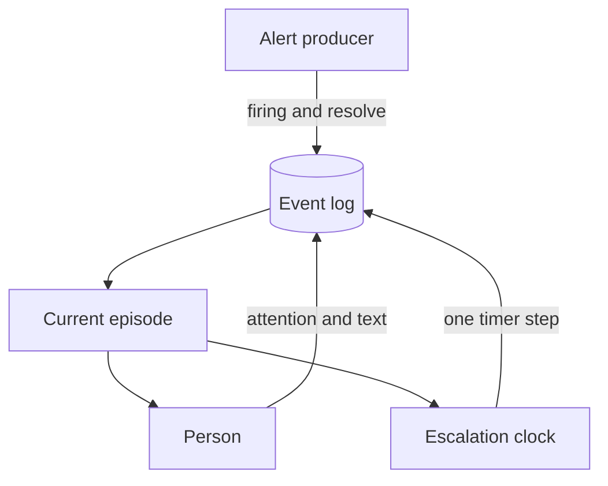
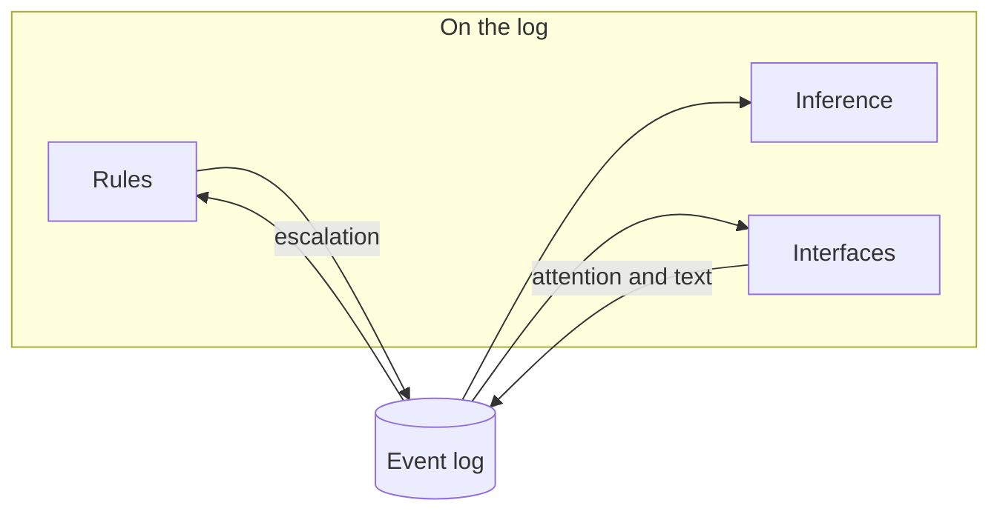
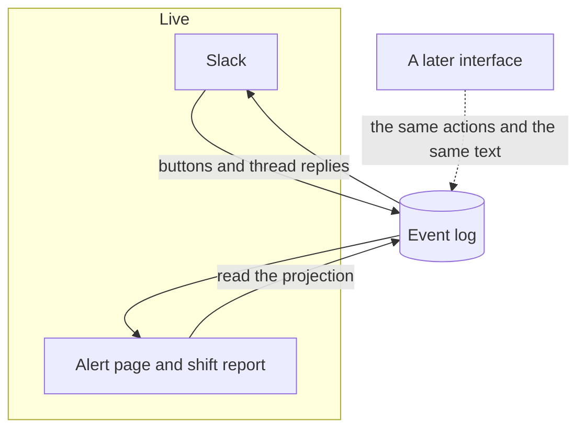

# System shape

P8 is a log of alert episodes and the human attention on them. An alerting system appends a firing or a resolve by posting a structured alert event ([alert intake](../contracts/alert-intake.md)). A person appends attention and text through an interface. Current state is a projection of that log. The same event and the same attention update always take the same path.

The producer and the person never write each other's facts. A resolve does not close the person's loop. Done does not clear the condition. Those two tracks are drawn in [Attention and condition](p8-app/attention-and-condition.md).

## Three layers

Rules, inference, and interfaces all sit on the same log. An interface can be replaced. The rules stay.

| Layer | Writes today | Reads |
| --- | --- | --- |
| **Rules** | The escalation row, when a critical episode is still unanswered | The log, through the projection |
| **Inference** | Nothing. A paragraph is shown on the report and is not stored | The projection and the typed replies |
| **Interfaces** | Attention and text, from whoever is using that interface | The projection |

### Rules

Episode open and close, attention (`recorded`, `open`, `owned`, `ignored`), and the discrepancy between Done and a resolve. One timer exists. It starts when a critical firing is stored, and it appends one escalation if that episode is still unanswered. A timer that starts from a later human action is not in this version.

The rules are deterministic. They do not call a model.

### Inference

The report page can ask for one paragraph about the shown window. The model reads the same episodes as the table, plus the typed replies on those episodes. The paragraph is shown under the stats. It is not stored. With no model configured, the request returns nothing and the table stays as it is. The rules still do not parse the text.

### Interfaces

An interface is how a person reads the episode and writes attention or text back. Slack is one. The alert page and the shift report are another. A later interface uses the same actions and the same stored text.

Slack is convenient because a thread already has buttons and a place to type. The buttons are the attention actions. The typed reply is the text. Another interface can collect both without Slack. The Slack app itself is recorded in [Slack app](../slack/configuration.md).

The alert page and the shift report read the projection. They do not append attention or text yet.

## Where the detail lives

| Topic | Note |
| --- | --- |
| Version 1 decisions | [Design](../design.md) |
| Attention, condition, discrepancy | [Attention and condition](p8-app/attention-and-condition.md) |
| Slack app settings | [Slack app](../slack/configuration.md) |
| What is built next | [Roadmap](../roadmap.md) |

When inference or another interface starts writing, add that writer here.
